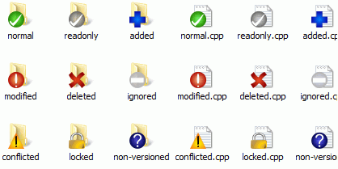

# 🧩 SVN Statuscodes erklärt

Diese Seite erklärt die wichtigsten Statuscodes von:

```bash
svn status
```

SVN zeigt damit den Zustand von Dateien und Ordnern in deiner lokalen Working Copy an.

---

## 🔍 Beispielausgabe

```text
M       src/App.java
A       src/NewService.java
D       src/OldService.java
?       notes.txt
!       src/MissingFile.java
C       src/Config.java
```

Die erste Spalte ist der wichtigste Statuscode.

---

## 🧭 Häufige Hauptstatuscodes

| Code | Bedeutung   | Erklärung                                    |
|------|-------------|----------------------------------------------|
| `A`  | Added       | Neu zur Versionskontrolle hinzugefügt        |
| `M`  | Modified    | Lokal geändert                               |
| `D`  | Deleted     | Lokal gelöscht                               |
| `?`  | Unversioned | Nicht unter Versionskontrolle                |
| `!`  | Missing     | Datei fehlt lokal, obwohl SVN sie erwartet   |
| `I`  | Ignored     | Wird durch Ignore-Regeln ignoriert           |
| `C`  | Conflicted  | Konflikt nach Update oder Merge              |
| `R`  | Replaced    | Gelöscht und durch neue Datei ersetzt        |
| `X`  | Externals   | Über `svn:externals` eingebunden             |
| `~`  | Obstructed  | Pfad ist blockiert oder hat unerwarteten Typ |

---

## ➕ `A` — Added

Die Datei oder der Ordner wurde mit `svn add` zur Versionskontrolle hinzugefügt, aber noch nicht committed.

```bash
svn add src/NewFile.java
svn status
```

Beispiel:

```text
A       src/NewFile.java
```

Beim nächsten Commit wird die Datei ins Repository übernommen.

```bash
svn commit -m "Add new file"
```

---

## ✏️ `M` — Modified

Die Datei wurde lokal verändert.

```text
M       src/App.java
```

SVN erkennt Unterschiede zwischen deiner lokalen Datei und der zuletzt ausgecheckten Repository-Version.

Änderungen anzeigen:

```bash
svn diff src/App.java
```

Änderung committen:

```bash
svn commit -m "Update App.java"
```

---

## ❌ `D` — Deleted

Die Datei oder der Ordner wurde mit SVN zum Löschen markiert.

```bash
svn delete src/OldFile.java
svn status
```

Beispiel:

```text
D       src/OldFile.java
```

Beim nächsten Commit wird die Datei auch im Repository gelöscht.

```bash
svn commit -m "Remove old file"
```

---

## ❓ `?` — Unversioned

Die Datei existiert lokal, ist aber nicht unter Versionskontrolle.

```text
?       notes.txt
```

Möglichkeiten:

### Datei versionieren

```bash
svn add notes.txt
svn commit -m "Add notes"
```

### Datei ignorieren

```bash
svn propset svn:ignore "notes.txt" .
svn commit -m "Ignore notes file"
```

### Datei lokal löschen

```bash
rm notes.txt
```

---

## ⚠️ `!` — Missing

Die Datei fehlt lokal, obwohl SVN sie erwartet.

```text
!       src/MissingFile.java
```

Das passiert häufig, wenn eine versionierte Datei manuell gelöscht oder verschoben wurde, ohne `svn delete` oder `svn move` zu verwenden.

### Datei wiederherstellen

```bash
svn revert src/MissingFile.java
```

### Löschung korrekt vormerken

```bash
svn delete src/MissingFile.java
svn commit -m "Remove missing file"
```

---

## 🙈 `I` — Ignored

Die Datei wird durch SVN-Ignore-Regeln ignoriert.

```text
I       node_modules
```

Ignorierte Dateien werden normalerweise nicht bei `svn status` angezeigt. Mit dieser Option sieht man sie trotzdem:

```bash
svn status --no-ignore
```

Ignore-Regeln anzeigen:

```bash
svn propget svn:ignore .
```

---

## ⚔️ `C` — Conflicted

Es gibt einen Konflikt, meistens nach:

```bash
svn update
```

oder:

```bash
svn merge <source>
```

Beispiel:

```text
C       src/Config.java
```

Typischer Ablauf:

```bash
# Datei manuell bearbeiten und Konflikt lösen

# Konflikt als gelöst markieren
svn resolve --accept=working src/Config.java

# Status prüfen
svn status

# Lösung committen
svn commit -m "Resolve conflict in Config.java"
```

---

## 🔁 `R` — Replaced

Eine Datei wurde gelöscht und an derselben Stelle durch eine neue ersetzt.

```text
R       src/SomeFile.java
```

Das kann passieren, wenn eine Datei gelöscht und danach eine neue Datei mit gleichem Namen hinzugefügt wurde.

---

## 🔗 `X` — Externals

Der Pfad stammt aus einer `svn:externals`-Definition.

```text
X       libs/shared
```

Das bedeutet: Der Ordner oder die Datei gehört nicht direkt zur aktuellen Working Copy, sondern wird aus einem anderen Repository-Pfad eingebunden.

Externals anzeigen:

```bash
svn propget svn:externals .
```

---

## 🚧 `~` — Obstructed

SVN erwartet an diesem Pfad einen anderen Typ.

Beispiele:

- SVN erwartet eine Datei, aber lokal liegt dort ein Ordner.
- SVN erwartet einen Ordner, aber lokal liegt dort eine Datei.
- Ein Pfad wurde manuell überschrieben.

Beispiel:

```text
~       src/config
```

Mögliche Lösung:

```bash
svn revert src/config
svn update
```

> Vorher prüfen, ob lokale Daten gesichert werden müssen.

---

## 🧱 Weitere Statusspalten

`svn status` kann mehrere Spalten anzeigen. Die erste Spalte ist der Hauptstatus. Weitere Spalten zeigen zusätzliche Informationen, z. B.:

- Property-Änderungen
- Locks
- Switched Paths
- Tree Conflicts
- Out-of-date Informationen

Beispiel:

```text
M      src/App.java
S  src/module
```

Die genaue Bedeutung hängt von der Position des Zeichens in der Ausgabe ab.

---

## 🧾 Property-Status

Wenn SVN-Properties geändert wurden, kann ein `M` in einer weiteren Spalte erscheinen.

Properties anzeigen:

```bash
svn proplist -v <path>
```

Property-Änderungen anzeigen:

```bash
svn diff <path>
```

Beispiel für eine Ignore-Property:

```bash
svn propset svn:ignore "node_modules" .
svn status
```

---

## 🔒 Lock-Status

Wenn dein Repository Locks verwendet, können Lock-Informationen im Status erscheinen.

Datei sperren:

```bash
svn lock <path> -m "Reason"
```

Datei entsperren:

```bash
svn unlock <path>
```

Status prüfen:

```bash
svn status
```

---

## 🔀 Switched Paths

Ein `S` kann anzeigen, dass ein Pfad innerhalb deiner Working Copy auf einen anderen Repository-Pfad zeigt als der Rest der Working Copy.

Das kann z. B. passieren nach:

```bash
svn switch <URL>
```

Informationen prüfen:

```bash
svn info <path>
```

---

## 🌳 Tree Conflicts

Tree Conflicts entstehen bei Konflikten in der Verzeichnisstruktur.

Beispiele:

- Datei wurde lokal geändert, aber im Repository gelöscht
- Datei wurde lokal verschoben, aber im Repository ebenfalls verändert
- Ordnerstruktur wurde gleichzeitig an mehreren Stellen geändert

Konflikte anzeigen:

```bash
svn status
```

Konflikt nach manueller Prüfung lösen:

```bash
svn resolve --accept=working <path>
```

---

## 🧹 Nützliche Befehle bei Statusproblemen

```bash
# Status anzeigen
svn status

# Details zur Working Copy anzeigen
svn info

# Lokale Änderungen anzeigen
svn diff

# Working Copy aktualisieren
svn update

# Working Copy reparieren
svn cleanup

# Lokale Änderung an Datei verwerfen
svn revert <path>

# Alle lokalen Änderungen rekursiv verwerfen
svn revert -R .
```

---

## 📌 Typische Fälle

### Lokale Änderung committen

```bash
svn status
svn diff
svn commit -m "Update files"
```

### Neue Datei hinzufügen

```bash
svn status
svn add <path>
svn commit -m "Add new file"
```

### Unversionierte Datei ignorieren

```bash
svn propset svn:ignore "<filename>" .
svn commit -m "Update ignore rules"
```

### Fehlende Datei wiederherstellen

```bash
svn revert <path>
```

### Konflikt lösen

```bash
# Datei manuell korrigieren
svn resolve --accept=working <path>
svn commit -m "Resolve conflict"
```

---

## 🖼️ TortoiseSVN Statussymbole

Weitere Informationen zu TortoiseSVN-Statussymbolen:

[SVN Tortoise – Statusinformationen anzeigen](https://tortoisesvn.net/docs/release/TortoiseSVN_de/tsvn-dug-wcstatus.html)



